# 阳小妮 · DSH Go 像素宠物包

一只照着作者自家白猫画的**手绘像素宠物**：头顶小灰斑、粉色耳内、大黑眼，旁边摆着米色小狮子玩偶，还有一条会摆的尾巴。
26 段序列帧动画，会在 DSH Go 里跟着会话状态动作、对点击和拖动做出反应。

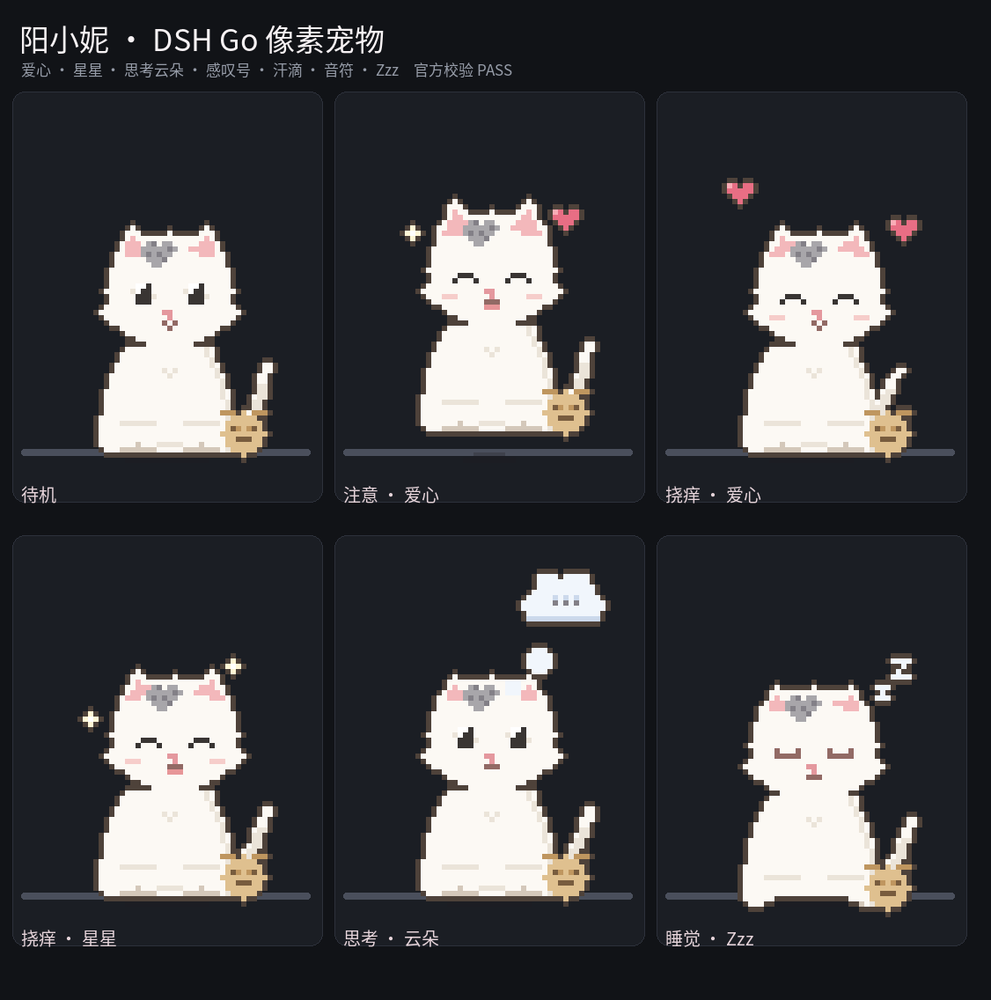


> **非官方作品**。这是给 [DSH Go / DeepSeek Harness](https://github.com/ccch1mneyyy/dsh-go) 做的社区宠物包，不是官方吉祥物。
> 格式遵循 dsh-go 的 `docs/design/pets.md` schema 1；校验通过 app 自带的 `pet_pack_check.py --compat-reactions`。

| 项目 | 值 |
| --- | --- |
| 包 id / 名字 | `yang-xiaoni` / 阳小妮 |
| 画布 | 56×72 美术像素（头顶留白给云朵/爱心） |
| 倍率 | `pixelArt: true`、`scale: 1` |
| 身体框 / 脚线 | 35×48 美术像素 / baseline 66 |
| 动画 | 31 段（7 段待机小剧场 + 12 个状态 + 2 段状态彩蛋 + 9 个互动反应 + 1 段拖动） |
| 体积 | zip 约 88 KB（32 个文件） |
| 校验 | 官方 `pet_pack_check.py --compat-reactions`：**PASS** |

## 安装

1. 下载 [`dist/yang-xiaoni.zip`](dist/yang-xiaoni.zip)（或 Releases 里的附件）。
2. DSH Go → **设置 → 宠物 → 导入**，选这个 zip。
3. 在选择器里选中「阳小妮」→ **启用宠物**。

大小建议：像素包在「标准」档是 k=2（每个美术像素占 2 个物理像素，身体约 34dp）；
觉得小就切「大」（k=3，约 51dp）或「自定义」（最高约 85dp），整数倍放大不会糊。

> 早期测试版用过 id `xiao-bai`。如果你装过，再导入这一版会多出一只旧宠物，长按删除旧的即可。

## 动效

- **待机**：呼吸、尾巴轻摆；空闲时随机眨眼、左右张望、冒爱心、伸懒腰、**舔爪洗脸**、**踩奶**、**打哈欠**
- **注意**：蹦跳眯眼笑 + 爱心和星星，35% 概率「爱心爆发」彩蛋
- **思考**：歪头压耳，头顶飘**思考云朵**（云里三个点，小泡泡一朵朵往上冒）；3.6 秒一段，中间会抬头看云、眨眼
- **思考彩蛋**：**被一只小飞蛾吸引**——头跟着飞虫转、耳朵抖动，最后伸爪去够
- **干活**：**追红点**——一颗红点围着猫转，猫压低身子、甩尾巴、伸爪去拍，偶尔扑一下
- **干活彩蛋**：**玩毛线球**——毛线球从右边滚过去，拖着线头，猫伸爪拨弄，最后冒个爱心
- **多任务 / 出错 / 通知 / 压缩 / 搬运 / 游走 / 唤醒 / 睡觉**：各有对应动作与道具（汗滴、感叹号、音符、灰尘、Zzz）
- **点左 / 点右**：2.0 秒的歪头反应，随机带星星或小爱心（左右各两种变体）
- **挠痒**：三种随机反应——爱心连发 / 星星雨 / 害羞甩头（1.5–1.7 秒）
- **连点第 6 下**：恼了，1.8 秒炸毛 + 感叹号 + 耳侧冒蒸汽；**拖动**：被拎起来的挤压姿势

动画时长按 Deepy 小鲸鱼、鲸娘两只参考宠物重排：点按 2.0 s、挠痒 1.5–1.7 s、状态循环 1.2–3.6 s，
统一 50–100 ms/帧（10–20 fps）。

## 什么时候会出现哪个动作（如实说明）

宠物包只提供动画，**什么时候播由 App 的状态机和你的手指决定**。所以：

| 你会看到 | 触发条件 | 频率 |
| --- | --- | --- |
| 思考 | 等模型、推理、重试时 | 长任务里最常见 |
| 干活 | 工具运行、回复流式输出时 | 长任务里常见 |
| 注意（+35% 爱心彩蛋） | 一整轮结束后 1.5 秒内没有新轮次 | 每轮结束一次，约 5.2 秒 |
| 通知 / 出错 / 压缩 / 搬运 | 有待确认、一轮出错、压缩上下文、导入宠物包 | 事件驱动 |
| 睡觉 / 唤醒 | 90 秒无操作 | 空闲时 |
| 点按 / 挠痒 / 恼了 / 拖动 | 手指交互 | 你点才有 |
| 思考彩蛋 / 干活彩蛋 | 状态**进入时**按概率抽一次（思考 25%、干活 20%） | 每次进状态一次 |
| 待机小剧场 | 空闲时按 40–280 秒随机间隔插播 | 空闲时 |

所以长时间连续任务里主要看到的是**思考**和**干活**，这不是包坏了；`注意` 和 `爱心爆发` 要等一轮结束。
彩蛋是「进入状态时抽一次」，不是循环播放。

## 全部动画一览

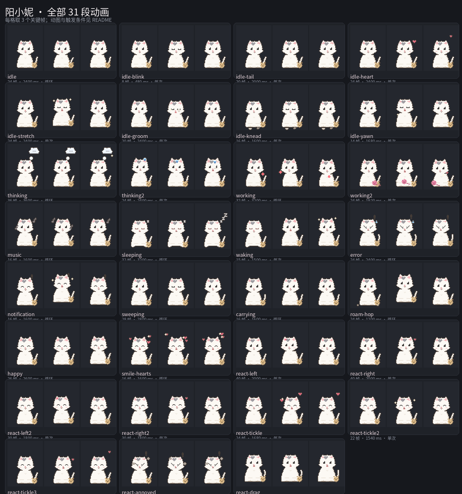

点开下面每一格的动图，就能看到对应动画的实际节奏（含触发条件）。

### 待机小剧场（空闲时随机插播）

| 动画 | 触发条件 | 动图 |
| --- | --- | --- |
| `idle` | 基础待机循环：呼吸 + 尾巴轻摆 |  |
| `idle-blink` | 空闲随机：眨眼 | 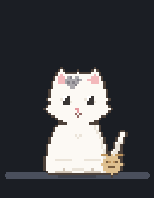 |
| `idle-tail` | 空闲随机：左右张望 | 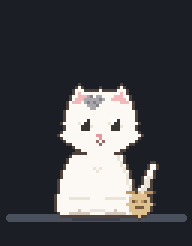 |
| `idle-heart` | 空闲随机：冒一颗爱心 |  |
| `idle-stretch` | 空闲随机：伸懒腰 |  |
| `idle-groom` | 空闲随机：舔爪洗脸 | 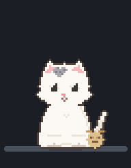 |
| `idle-knead` | 空闲随机：踩奶 | 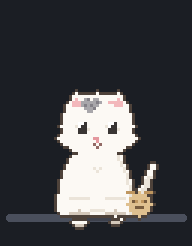 |
| `idle-yawn` | 空闲随机：打哈欠 |  |

### 状态动画

| 动画 | 触发条件 | 动图 |
| --- | --- | --- |
| `thinking` | 等模型 / 推理 / 重试时（长任务里最常见） | 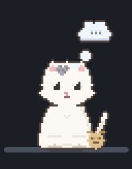 |
| `thinking2` | 思考彩蛋：盯飞蛾 + 伸爪，进入思考状态时 25% 抽一次 | 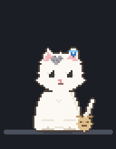 |
| `working` | 工具运行、回复流式输出时：追红点（压低身子、甩尾、拍爪） | 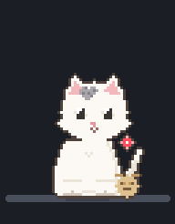 |
| `working2` | 干活彩蛋：玩毛线球，进入干活状态时 20% 抽一次 | 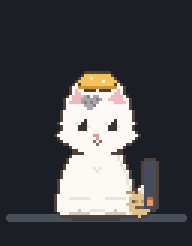 |
| `music` | 多任务：同时有多个会话在跑 | 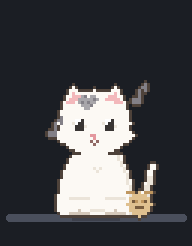 |
| `happy` | 注意：一整轮结束且 1.5 秒内没有新轮次（约 5.2 秒） |  |
| `smile-hearts` | 注意彩蛋：进入注意状态时 35% 抽一次 | 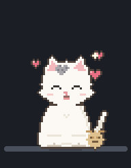 |
| `error` | 一轮出错 | 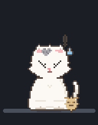 |
| `notification` | 有待确认 / 待回答的问题 | 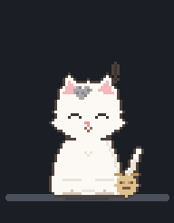 |
| `sweeping` | 压缩上下文时 |  |
| `carrying` | 导入宠物包时 |  |
| `sleeping` | 90 秒无操作入睡 | 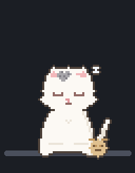 |
| `waking` | 睡觉时被碰一下 | 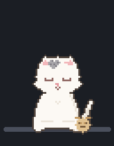 |
| `roam-hop` | 空闲时随机走动 |  |

### 手指互动

| 动画 | 触发条件 | 动图 |
| --- | --- | --- |
| `react-left` | 点身体左半边（与 left2 各 50% 随机） |  |
| `react-left2` | 点身体左半边（爱心变体） | 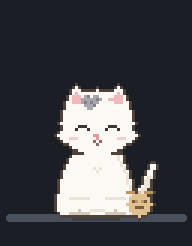 |
| `react-right` | 点身体右半边（与 right2 各 50% 随机） |  |
| `react-right2` | 点身体右半边（爱心变体） |  |
| `react-tickle` | 1.1 秒内连点 3 下：爱心连发（三种随机之一） |  |
| `react-tickle2` | 连点 3 下：星星雨（三种随机之一） |  |
| `react-tickle3` | 连点 3 下：害羞甩头（三种随机之一） |  |
| `react-annoyed` | 1.1 秒内连点 6 下（App 侧阈值）；第 7 下会被顶掉 | 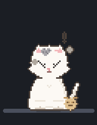 |
| `react-drag` | 按住拖动时 | 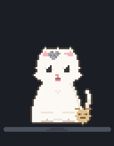 |

## 构建与校验

```sh
python3 -m venv .venv && . .venv/bin/activate
pip install -r requirements-dev.txt

make build          # tools/build_pack.py -> pack/ + dist/yang-xiaoni.zip
make check          # 自研校验：导入门 + 市场元数据
make check-official # 下载 pinned commit 的官方 pet_pack_check.py 并校验（需要网络）
make test           # pytest：几何/引用/确定性/包是否与源码同步
make preview        # 重新生成 screenshots/
```

整个包由 `tools/sprite.py` + `pack-meta.json` 生成：PNG 不带元数据、zip 用固定时间戳，
同样的输入每次构建逐字节一致（`make test` 会检查）。

## 仓库结构

| 路径 | 说明 |
| --- | --- |
| `pack/` | 已生成的宠物包（`pack.json` + 26 张序列帧 PNG） |
| `dist/` | 发布用 zip（`make build` 生成，git 忽略） |
| `pack-meta.json` | id / 名字 / 作者 / 许可 / 来源，构建时写进 `pack.json` |
| `tools/sprite.py` | 像素渲染器：调色板、猫的部件、思考云朵/爱心/星星等道具 |
| `tools/build_pack.py` | 逐帧采样动画 → 裁帧 → 拼序列帧图 → 写 `pack.json` → 打确定性 zip |
| `tools/validate_pack.py` | 无依赖校验器（导入门、几何、引用、zip、市场元数据） |
| `tools/preview.py` | 生成 `screenshots/preview.png` 与 `preview.gif` |
| `tools/gallery.py` | 生成 `screenshots/anim/*.gif`（每段动画一个动图）与 `animations.png` |
| `tools/fetch-official-checker.sh` | 拉取官方 checker（pinned commit，不入库） |
| `tests/` | pytest 测试 |
| `screenshots/` | 截图与动图（`preview.*`、`animations.png`、`anim/*.gif`） |
| `docs/` | 包格式摘要、发布规范、设计说明 |

## 这个包的「规范」依据

- **格式**：dsh-go `docs/design/pets.md` §3 的 schema 1（`pack.json` 字段、`frameW = box.w × scale`、序列帧图与 `cols`）。
- **流程**：app 自带 `pet-theme` 技能的 `SKILL.md`——生成 → `pet_pack_check.py` 必须 PASS → 打包成 `pack.json` 在顶层的 zip。
- **机器可读规则**：dsh-go `app/tool/pet-pack.rules.json`（导入门、市场规范化、体积/条目限制）。
- **社区要求**：`author`/`license`/`source` 如实填写并显示在宠物页底部；注明「非官方」；不打包第三方素材。
- **跨版本兼容**：`reactions` 用「基础名 + 编号」写法（`tickle`、`tickle2`…），不写数组，旧版 App 只读基础名也能跑。

照着这些整理出的发布清单见 [`docs/publishing.md`](docs/publishing.md)。

## 许可

- **代码**（`tools/`、`tests/`、构建脚本）：MIT，见 [`LICENSE`](LICENSE)。
- **美术**（`pack/`、`screenshots/` 里的像素画与动画）：CC BY-NC-SA 4.0，见 [`LICENSE-ART.md`](LICENSE-ART.md)。
- 商用前请联系作者；`pack.json` 的 `author`/`license`/`source` 会原样显示在 DSH Go 宠物页底部。

## English

*Yang Xiaoni* is a community pixel-pet pack for DSH Go (schema 1): a hand-drawn pixel cat with
31 frame animations, touch reactions (hearts, sparkles, thought cloud, etc.) and a deterministic
build. Install the zip via **Settings → Pets → Import**. Code MIT, artwork CC BY-NC-SA 4.0.
Not an official DSH Go asset.

## 更新记录

见 [`CHANGELOG.md`](CHANGELOG.md)。贡献方式见 [`CONTRIBUTING.md`](CONTRIBUTING.md)。
